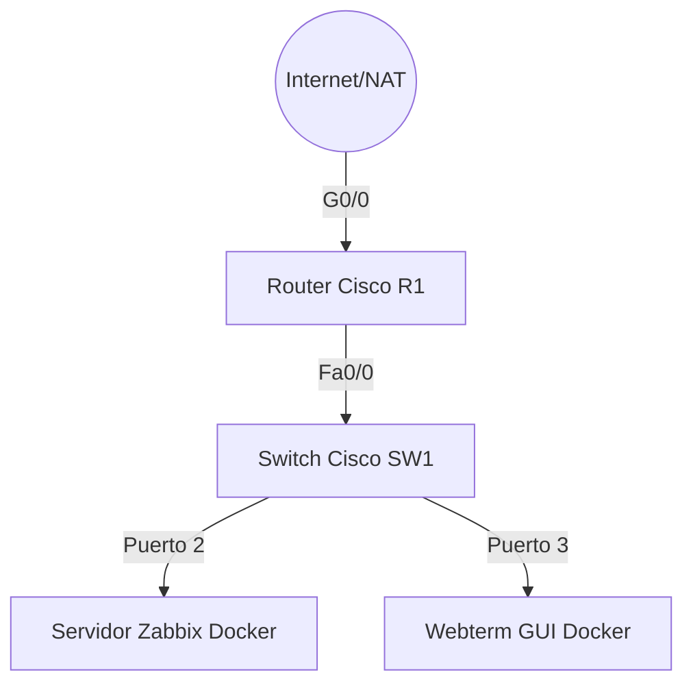

# Laboratorio de Monitoreo de Redes con SNMP y Zabbix (GNS3)

[](https://www.youtube.com/watch?v=TU_ID_DE_VIDEO)
*Haz clic en la imagen superior para ver el video demostrativo del funcionamiento, la recolección de datos SNMP en tiempo real y el tráfico generado en las gráficas.*

---

## Índice
1. [Propósito del Laboratorio](#1-propósito-del-laboratorio)
2. [Topología de Red y Arquitectura](#2-topología-de-red-y-arquitectura)
3. [Tabla de Direccionamiento IP](#3-tabla-de-direccionamiento-ip)
4. [Diario de Configuración y Troubleshooting Operativo](#4-diario-de-configuración-y-troubleshooting-operativo)
5. [Configuraciones Implementadas Paso a Paso](#5-configuraciones-implementadas-paso-a-paso)
6. [Políticas de Seguridad (Firewall Policies)](#6-políticas-de-seguridad-firewall-policies)
7. [Validación y Pruebas Analíticas](#7-validación-y-pruebas-analíticas)
8. [Diagramas y Evidencias Visuales](#8-diagramas-y-evidencias-visuales)
9. [Running Configurations Completas](#9-running-configurations-completas)
10. [Scripts y Archivos Utilizados](#10-scripts-y-archivos-utilizados)
11. [Conclusión](#11-conclusión)

---

## 1. Propósito del Laboratorio
Este laboratorio tiene como objetivo principal implementar un entorno de red funcional utilizando GNS3, que integre servicios de enrutamiento, conmutación y asignación dinámica de direcciones (DHCP), para posteriormente ser monitoreado de manera centralizada mediante un servidor Zabbix en contenedor Docker. Se busca validar la correcta recolección de telemetría, rendimiento (CPU/RAM) y tráfico de interfaces a través del protocolo SNMPv2, utilizando identificadores únicos de estudiante (matrícula 20240886) para asegurar la autoría y seguridad de las configuraciones.

## 2. Topología de Red y Arquitectura

La arquitectura se basa en una red LAN plana conectada mediante un switch de capa 2.



*Figura 1: Diagrama lógico de la topología emulada en GNS3.*

## 3. Tabla de Direccionamiento IP
Red Base: `10.8.86.0/24` (Subred derivada de la matrícula del estudiante).

| Dispositivo | Interfaz | Dirección IP | Máscara | Gateway | Notas |
| :--- | :--- | :--- | :--- | :--- | :--- |
| **R1** | Fa0/0 | 10.8.86.1 | 255.255.255.0 | N/A | Servidor DHCP / Agente SNMP |
| **SW1** | Vlan1 | 10.8.86.2 | 255.255.255.0 | 10.8.86.1 | Agente SNMP |
| **Zabbix** | eth0 | 10.8.86.11 | 255.255.255.0 | 10.8.86.1 | Asignado por DHCP. Servidor NMS. |
| **Webterm** | eth0 | 10.8.86.12 | 255.255.255.0 | 10.8.86.1 | Asignado por DHCP. Consola de gestión. |

## 4. Diario de Configuración y Troubleshooting Operativo

Durante el desarrollo de la topología en GNS3, se presentaron y resolvieron los siguientes desafíos operativos:

*   **Falta de Memoria en Zabbix (OOM):** El contenedor Docker *zabbix-appliance* presentaba un comportamiento inestable y cierres del proceso web al inicializar la base de datos MariaDB debido a los recursos por defecto (256MB). Se solucionó permitiendo un tiempo mayor de emulación y validando el puerto 80 mediante peticiones HTTP hasta que el servicio reportara estado "OK".
*   **Asignación de Templates SNMP:** Se identificó que la versión de Zabbix requería el uso de *Template Modules* individuales en lugar de plantillas monolíticas. Se vincularon exitosamente los módulos `CISCO-PROCESS-MIB`, `CISCO-MEMORY-POOL-MIB`, `Inventory` e `Interfaces`.
*   **Falsos positivos de Zabbix Agent:** Se detectó un error `ZBX` (rojo) en la disponibilidad debido a la presencia por defecto de la interfaz "Agent" en los Hosts de Cisco. Se resolvió eliminando la interfaz Agent y dejando exclusivamente la interfaz **SNMP** en el puerto 161.
*   **Fallo en el Descubrimiento LLD (Interfaces):** Zabbix no lograba graficar el tráfico de red de los puertos (FastEthernet). El análisis reveló que los nodos de GNS3 Cisco IOS rechazan peticiones SNMP en bloque. Se resolvió **deshabilitando "Use bulk requests"** en la configuración de la interfaz SNMP dentro de Zabbix, forzando la recolección exitosa.

## 5. Configuraciones Implementadas Paso a Paso

1.  **Configuración de Direccionamiento IP y DHCP (R1):** Asignación de la subred 10.8.86.0/24 y configuración del pool DHCP para aprovisionar dinámicamente a los contenedores Docker.
2.  **Configuración SNMP en Nodos Cisco:** Habilitación de SNMP versión 2c en R1 y SW1 con la comunidad *Read-Only* preestablecida.
3.  **Despliegue de Docker en GNS3:** Inicialización del nodo Zabbix y Webterm. Ajuste del Webterm para obtener IP vía DHCP editando su `/etc/network/interfaces`.
4.  **Integración de Equipos en Zabbix:**
    *   Creación del Host `R1` y `SW1`.
    *   Configuración de la interfaz SNMP apuntando a las IP `.1` y `.2`.
    *   Registro de la Macro `{$SNMP_COMMUNITY}` = `snmp20240886`.
    *   Vinculación de módulos Cisco.
    *   Desactivación de las peticiones en lote (Bulk Requests).

## 6. Políticas de Seguridad (Firewall Policies)

Dado el alcance del laboratorio (LAN), las políticas de seguridad se centraron en la protección del plano de gestión (Management Plane):
*   **Comunidad SNMP Restringida:** Se utilizó una cadena de comunidad no convencional (`snmp20240886`) para evadir los diccionarios por defecto.
*   **Restricción de Privilegios:** La comunidad SNMP se configuró estrictamente con permisos de **Solo Lectura (RO)**, previniendo alteraciones no autorizadas en la configuración del enrutamiento desde la plataforma Zabbix.

## 7. Validación y Pruebas Analíticas

*   **Prueba de Conectividad Base:** Se ejecutaron comandos `ping` exitosos desde Webterm hacia R1 (Gateway) y Zabbix (NMS) para confirmar el enrutamiento y conmutación.
*   **Prueba de Disponibilidad NMS:** Se utilizó `watch -n 5 curl -s -I http://10.8.86.11` para verificar el levantamiento de los servicios web de Zabbix.
*   **Pruebas de Estrés en Red:** Se generó tráfico ICMP masivo (`ping 10.8.86.1 -s 1500 -c 5000`) desde el Webterm para forzar la saturación de los contadores en las interfaces de red de R1.
*   **Validación de Telemetría:** Se comprobó mediante la sección *Latest Data* y *Graphs* en Zabbix que la ráfaga de tráfico generó un pico visual preciso en la gráfica "Bits received / Bits sent", validando el Low-Level Discovery (LLD).

## 8. Diagramas y Evidencias Visuales

### Topología en GNS3
*(Reemplazar con una captura de GNS3 donde se vean los nodos verdes)*


### Zabbix SNMP Verde (Disponibilidad)
*(Reemplazar con captura de Configuration > Hosts mostrando R1 y SW1 con el SNMP verde)*


### Gráfica de Tráfico con Carga (Ping Sweep)
*(Reemplazar con captura de la gráfica subiendo debido al Ping)*


## 9. Running Configurations Completas

Para mantener la documentación limpia, los archivos de configuración completa (`running-config`) extraídos de los equipos de red se han incluido como archivos adjuntos en la raíz de este repositorio:

*   📄 [Ver Configuración de R1 (Router)](R1_running_config.txt)
*   📄 [Ver Configuración de SW1 (Switch)](SW1_running_config.txt)

## 10. Scripts y Archivos Utilizados

A continuación, se listan los comandos clave / scripts ejecutados durante las pruebas analíticas en los contenedores:

**1. Script de espera HTTP (Webterm):**
Validación del estado del servidor web antes de iniciar la gestión:
```bash
watch -n 5 curl -s -I http://10.8.86.11
```

**2. Script de Generación de Carga de Red (Webterm):**
Inyección de tráfico pesado para alterar las gráficas de interfaces:
```bash
ping 10.8.86.1 -s 1500 -c 1000
```

**3. Configuración de Red Local (Webterm - /etc/network/interfaces):**
```text
auto eth0
iface eth0 inet dhcp
```

## 11. Conclusión
El entorno de red se implementó satisfactoriamente, demostrando que mediante la integración de GNS3 y contenedores Docker se puede replicar un escenario real de monitoreo. Se comprobó el impacto de configuraciones avanzadas del protocolo SNMP (como el manejo de Bulk Requests en equipos legados de Cisco) y se validó la recolección exitosa de datos de hardware e interfaces a través de Zabbix. La personalización de la red y comunidades con credenciales estudiantiles (20240886) reafirma el dominio práctico de los conceptos de administración de redes.